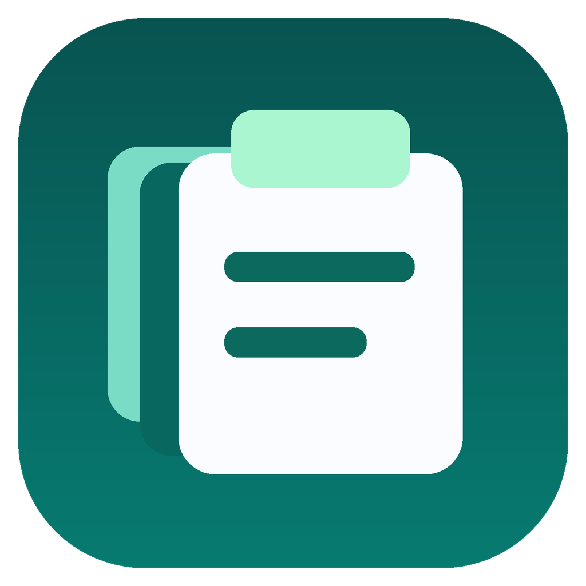
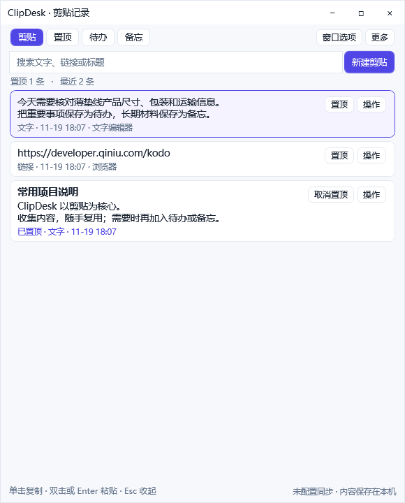
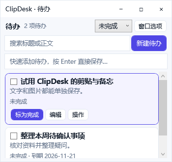
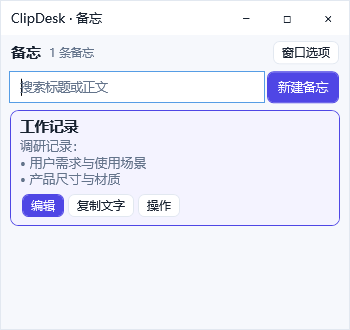
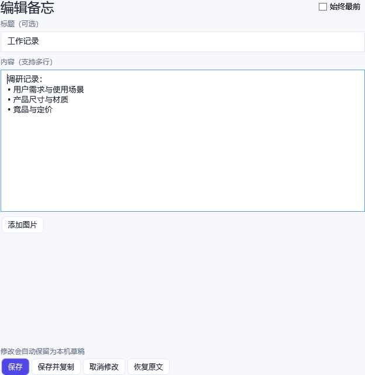

<div align="center">
  
  <h1>ClipDesk</h1>
  <p>以剪贴板为首页的 Windows 个人效率工具：剪贴历史 · 置顶常驻 · 待办清单 · 图文备忘 · 端到端加密云同步</p>
  <p>
    <a href="https://github.com/Rinyanami/ClipDesk/releases"></a>
    
    
  </p>
</div>

**当前为 0.4.0 版本。** 所有剪贴记录、图文附件与草稿默认优先保存在本机 SQLite（未配置七牛云时完全离线运行）；支持全局热键秒弹唤醒、双击/回车回填原输入框、独立透明常驻桌面面板，以及基于客户端加密的 S3（七牛 Kodo）多设备增量同步。

## 界面演示

| 剪贴历史主窗口 | 常驻待办面板（顶部回车秒建） |
| :---: | :---: |
|  |  |

| 常驻备忘面板 | 备忘编辑器（自动本机草稿 + Ctrl+V 贴图） |
| :---: | :---: |
|  |  |

## 核心特性（v0.4.0）

- **秒开响应与极速列表**：唤醒前异步限时抓取前台窗口焦点（35ms 超时兜底），列表卡片视图复用与轻量资产检测彻底消除 UI 线程卡顿；WAL 模式 SQLite 极速落盘。
- **可靠回填与去重排序**：支持浏览器、微信、VS Code 等现代应用的双击 / `Enter` 原位粘贴回填；主「剪贴」列表纯时间倒序排列，连续相同复制自动去重不刷屏。
- **多面板桌面常驻**：剪贴、置顶、待办、备忘支持各自独立窗口、自由摆位、保持显示、始终最前、独立快捷键及未激活时平滑透明度渐变。
- **本机草稿与冲突保护**：编辑停顿自动保存本机草稿，支持在草稿管理中继续编辑或丢弃；并发编辑保留全部版本，杜绝静默覆盖。
- **待办与图文备忘增强**：待办支持面板顶部一行回车秒建、一键勾选完成与逾期/今日到期高亮标识；编辑器支持直接按 `Ctrl+V` 粘贴剪贴板截图作为附件。
- **端到端加密同步与备份**：可选配置七牛 Kodo S3 对象存储进行跨设备加密增量同步（凭据仅存本机 Windows 凭据管理器），亦支持完整 ZIP 备份导出与恢复。

## 下载与使用

- 前往 [**Releases**](https://github.com/Rinyanami/ClipDesk/releases) 下载：
  - `ClipDesk-0.4.0-win-x64-setup.exe`（推荐，中文安装器，无需额外安装 .NET）
  - `ClipDesk-0.4.0-win-x64.zip`（自带运行时便携包，解压即用）
- 默认快捷键为 `Ctrl+Shift+V`（可在「设置 → 本机使用」修改，并可分别配置置顶/待办/备忘全局热键）。详细指南见 [使用说明.md](使用说明.md)。

## 运行与构建

开发环境使用 .NET 10 SDK、PowerShell，Windows 10/11 x64：

```powershell
# 编译 Release 并运行 120+ 项自动化校验 + 生成便携包
.\build.ps1 -Portable -Verify

# 生成中文 NSIS 安装包
.\package.ps1
```

- 编辑器与草稿专项校验：`tests/ClipDesk.EditorChecks/run.ps1`（使用隔离数据库，不写系统剪贴板）。
- 可选 `-NativeChecks`：在独立非交互式 Windows 窗口站中检查合成剪贴内容。
- 用户数据默认位于 `%LOCALAPPDATA%\ClipDesk`；开发验收可通过环境变量 `CLIPDESK_DATA` 指定隔离目录。

## 项目文档

- [docs/需求与技术决策.md](docs/需求与技术决策.md)：架构设计、数据模型与加密同步协议。
- [docs/七牛联调.md](docs/七牛联调.md)：七牛 Kodo S3 空间配置与多机同步验证说明。
- [docs/验收记录.md](docs/验收记录.md)：自动化检查范围、实测结果与边界说明。
- [docs/0.3.0更新说明.md](docs/0.3.0更新说明.md) · [docs/问题审查清单.md](docs/问题审查清单.md) · [docs/本机安装记录.md](docs/本机安装记录.md)
